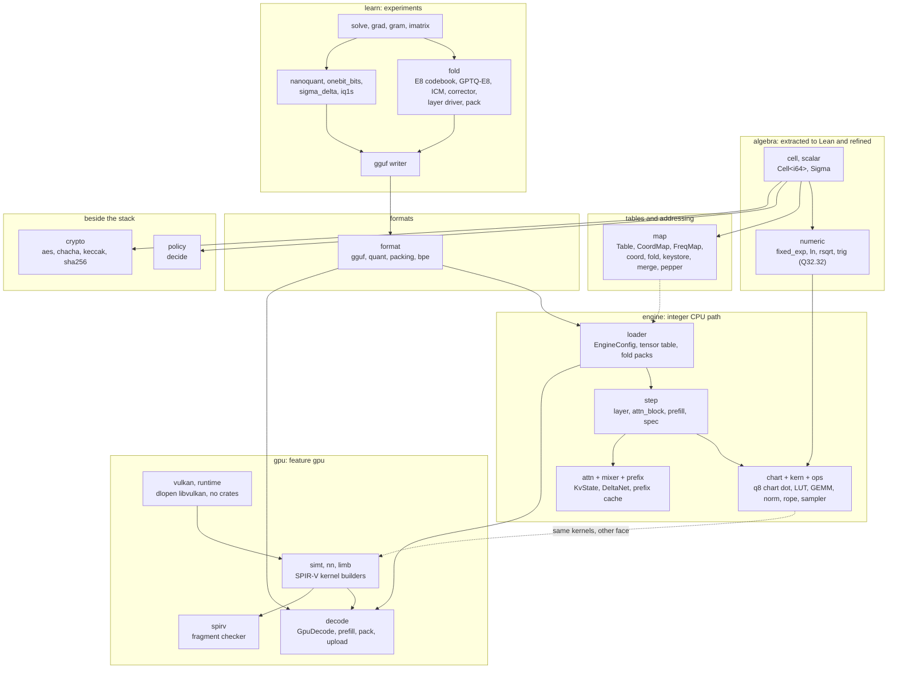
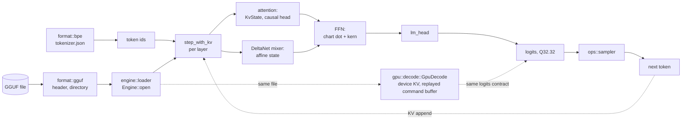
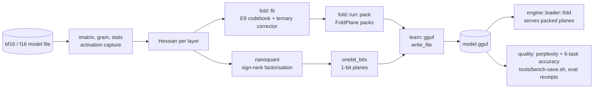
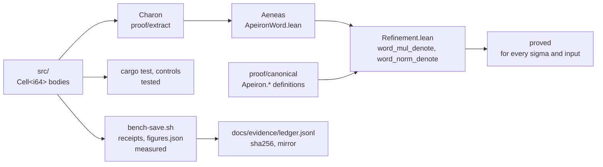

# Architecture

One page for the shape of the crate. Programme decisions are in [`direction.md`](direction.md), the
trust boundary is in [`kernel-boundary.md`](kernel-boundary.md), and the proofs are in
[`../proof/README.md`](../proof/README.md). This page owns the module map and the data flow, and
points at those for everything else. Source and gates win over this page.

## The layers

Everything sits on one algebra, `R[x]/(x² − σ)`. A `Cell` is a pair over a ring, and `Sigma` picks
the face: elliptic, parabolic or hyperbolic. Each layer uses the layer below and nothing above.

A solid arrow is a use. A dotted arrow is a correspondence kept by tests, not a call. The `map` to
`loader` link is dotted because the engine reads tensors by byte range from the file, and the tables
serve addressing elsewhere in the crate.

## One decode step

A prompt becomes tokens, tokens become a row of logits, the sampler picks one. The CPU and GPU
paths have the same stages and the same arithmetic contract: no float in the executing path, every
product checked, a failure is an error and never a wrap.

| stage | entry point | where |
|---|---|---|
| open and resolve config | `Engine::open` | `src/engine/loader.rs` |
| one token | `Engine::step_with_kv`, `step_logits` | `src/engine/step.rs` |
| a whole prompt | `Engine::prefill_state` | `src/engine/step.rs` |
| projections | `matvec_q8act`, the LUT and GEMM kernels | `src/engine/chart/`, `src/engine/kern/` |
| device decode | `GpuDecode::new`, `new_with_prefill` | `src/gpu/decode/model.rs` |

## Quantisation: how a model file is made

`learn` reads a model and writes one. It is where the 1.18 bits per weight work lives and where the
open quality gap is. The gate is board row `APEIRON-QUALITY-118-W1-T01`.

The ledger of what each arm measured is in [`evidence/perf-predictions.md`](evidence/perf-predictions.md)
and the receipts are under `docs/evidence/receipts/bench/`.

## Evidence: how a claim gets its grade

Rust is checked at three grades. Only the first reaches a proof.

| grade | means | covers |
|---|---|---|
| proved | a Lean theorem over the extracted body | the 64-bit cell multiplication and norm |
| tested | a test and a negative control pass | the table, the engine, the SPIR-V header check |
| measured | a saved receipt with source hash | every speed and quality figure |

What is not covered, below the extraction, is listed in
[`../book/src/verification/trust.md`](../book/src/verification/trust.md).

## Module map

| area | modules in `src/` | status |
|---|---|---|
| algebra | `cell`, `scalar`, `numeric` | extracted and refined for `Cell<i64>` |
| algebra, other | `carrier`, `exchange`, `kepler`, `attn_cut` | experiments, tested |
| tables | `map/` (`table`, `coord`, `fold`, `freq`, `count`, `keystore`, `merge`, `pepper`) | tested, refinement open |
| formats | `format/` (`gguf`, `quant`, `packing`, `bpe`) | tested, refuses on bad file data |
| engine | `engine/` (`loader`, `step`, `chart`, `kern`, `ops`, `attn`, `mixer`, `prefix`, `num`) | tested, bit-for-bit against `matvec_fixed` |
| GPU | `gpu/` (`vulkan`, `runtime`, `simt`, `nn`, `limb`, `decode`, `spirv`) | tested, behind feature `gpu` |
| learning | `learn/` (`fold`, `nanoquant`, `solve`, `grad`, `code`, `gguf`, ...) | experiments, no stability promise |
| policy | `policy/` | canonical target `Apeiron.Policy.decide` |
| crypto | `crypto/` | unaudited, known-answer vectors only |

Outside `src/`:

| path | role |
|---|---|
| `proof/` | Charon and Aeneas extraction, the refinement package, the canonical Lean corpus |
| `tools/` | gates and harnesses: `check-claims.py`, `book-check.py`, `bench-save.sh`, `gate`, `gpu-bench` |
| `tests/` | one focused test per mechanism, `learn_<x>.rs` for `learn` |
| `docs/` | programme documents; `docs/evidence/` holds the ledger, figures and receipts |
| `book/` | the reader-facing book |

## Build shape

- The default build has zero dependencies. `derive` pulls in `syn` and `quote` for the derive crate
  only. `read-stats` adds counters that stay out of the extraction unit.
- `gpu` enables `src/gpu` and the Vulkan runtime. The kernel builders in `simt` are always on, so
  the SPIR-V can be generated and checked without a device.
- `tools/gpu-bench` is its own manifest, so the benchmark harness is outside the crate and does not
  count against it.
