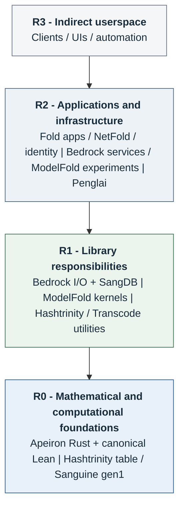
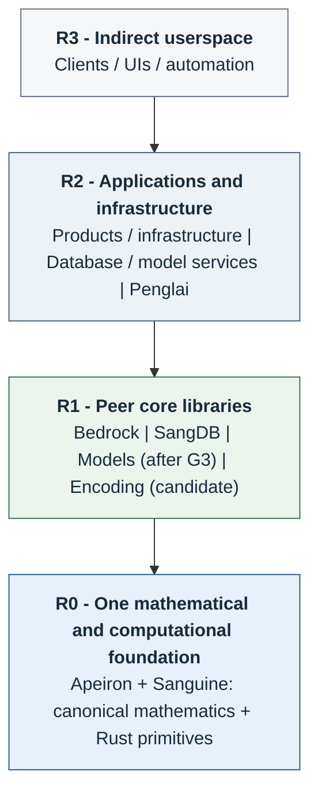

# RFC 0001: Core Architecture, Evidence Standards, and Fold Sunset

**Status:** Published for review 2026-09-11 as GitHub [`Ptyktos/fold#15`](https://github.com/Ptyktos/fold/issues/15) (short form), with this document as the full draft. Canonical GitLab publication on `twn/RnD/fold` (project 211) awaits explicit Lucas approval and has not occurred.  
**Scope of the verified claim:** the proven Apeiron slice is `Cell<i64>::mul` and `norm_form` refined against `Apeiron.Trichotomy.AnyRing`. The container (`src/map.rs`, `src/map/table.rs`; unsafe SIMD) is **not** in the Aeneas fragment. This RFC proposes a verified **primitive**, not a verified substrate.  
**Target:** `twn/RnD/fold` issue; GitHub mirror `Ptyktos/fold#15`.  
**Sponsor:** Lucas Rose-Winters. **Reviewer:** Clay Townsend (`@ctown`).

The key words **MUST**, **MUST NOT**, **SHOULD**, **SHOULD NOT**, and **MAY** are normative as defined by RFC 2119 and RFC 8174. A SHOULD exception MUST record its reason, owner, and acceptance test. MUST requirements require an explicit RFC amendment to change. These requirements take effect after Lucas and Clay approve the RFC; this draft does not authorize migration.

## 1. Decision

We will replace Fold's umbrella dependency model with a small, maintained library core. This section states three **separable** decisions. Each may be accepted or rejected independently; accepting one is not acceptance of the others.

- **D1 — Foundation.** Apeiron and the canonical Sanguine corpus MUST converge into one project and repository: mathematical specifications, Rust primitives, and implementation refinements. Fold MUST become a migration and historical repository, not a second evolving primitive stack.
- **D2 — Topology.** Bedrock, SangDB, and the model library MUST be peer ring-1 systems. Bedrock MUST NOT be the mandatory gateway to computation.
- **D3 — Admission standards.** Shared core membership MUST be earned by contracts and evidence, not imports, naming, or repository ancestry. A1–A8 below apply to every admitted package.

D3 may be accepted while D1 and D2 are deferred; D2 may be accepted while D1 is deferred. **No decision here gates the existing Bedrock runtime/transport work** (#11–#13): that work proceeds under its own contract (A2, A6) whether or not D1/D2 are accepted.

We will maintain four repository tracks: Apeiron, Bedrock, SangDB, and the model library. Shared encoding is a candidate core package; a fifth repository requires joint admission. New AI work is deferred behind the Apeiron/Song maturity gate **G3**. Existing GPU work will be preserved.

## 2. Why We Are Changing

| Problem | Required correction |
| --- | --- |
| Some Sanguine/Fold claims were not grounded in the operations the programs execute. | Trace public operations to implementations, specifications, and evidence. An import MUST NOT count as algebraic grounding. |
| The predecessor over-specialized the foundation to the split-complex/hyperbolic case. | Start from `R[x]/(x^2 - sigma)`. Preserve the real trichotomy and state the hypotheses of each specialization and base-ring instance. |
| Lean results and Rust behavior were linked strongly in some places and only by citations or assertions in others. | Separate proved specifications, implementation refinements, bounded checks, tests, and unproved claims. Require source-linked evidence for advertised guarantees. |
| Framework-specific names obscured standard mathematics and existing work. | Use **elliptic**, **parabolic**, **hyperbolic**, **sigma**, and standard algebraic terminology. Preserve historical terms in a migration glossary, not as replacement names for established mathematics. |
| Apeiron has stronger explicit contracts, progressive Aeneas/Kani evidence, and promising measured performance. | Prefer it as the common primitive. Every performance-sensitive migration MUST pass a matched correctness/performance comparison; neither stronger mathematics nor selected benchmarks prove a universal speedup. |

**Reproduced, not asserted.** The first row is not a category — it is a live defect. `modelfold/src/cast/phasefold/table.rs:164` `Table::unlearn` applies the cell column (`cnt.try_unfuse`) and then can reject the code column and panic, leaving `cnt` decremented while its own doc comment promises *"a refused unlearn leaves the table untouched."* That is a per-column guarantee presented as a whole-record transaction, and it is the defect A4 exists to reject. The reproduction, including the panicking key, is recorded in [`../../call-census/primitive-findings.md`](../../call-census/primitive-findings.md). (The call census labels the operation `Table::n`; the symbol was renamed `unlearn` before the pinned revision, so the census prose is stale there and MUST be regenerated before admission.)

The present structure preserves duplicate implementations, hidden dependency cycles, unclear support obligations, and proofs that can stay green while consumer behavior changes.

Over the real base: `sigma < 0` is elliptic, `sigma = 0` is parabolic, and `sigma > 0` is hyperbolic. Split-complex multiplication is the normalized hyperbolic case, not the entire family. This real classification MUST NOT be transferred unchanged to wrapping-word rings.

The call census inspected 2,813 Rust files at pinned revisions. It recorded 7,959 syntactic target-use sites, including constructors, with two known false attributions flagged and 38,852 unattributed candidate records. It is not a complete compiler call graph. Its source review establishes useful distinctions: the absorbed identity provider uses API substitutes; AAC uses a table cache; CountLM and SangDB use real count/index state; substantial numerical kernels remain local implementations.

## 3. Topology Today

This maps current responsibilities to the proposed rings; it does not claim those boundaries are already enforced. Repeated package names show where responsibilities are bundled together. The Fold snapshot is `4cc14471ae24f3f204fb0b0e91736ef75c909358`; Bedrock, OpsFold, and the absorbed provider have excluded or separate build cones.

[SVG diagram](diagrams/current.svg)

Layer arrows are a reading guide, not mandatory routes. Penglai calls R0 directly.

**Separate Song track:** Song shares the canonical mathematics and uses its pinned gen1 compiler. Whispering Tides currently uses gen1 Song interfaces.

| Current consumer | Actual relationship |
| --- | --- |
| Fold applications | Selected Bedrock and Hashtrinity APIs; OpsFold also uses NetFold. |
| Bedrock | Hashtrinity state/utilities; ModelFold under the serving feature. |
| ModelFold | Hashtrinity counts/indexes/utilities and Transcode input; substantial numerical code remains local. |
| Penglai | Apeiron directly; selected game kernels also refine canonical Lean definitions. |
| Apeiron Rust | Selected production kernels refine canonical Lean specifications through Aeneas. |
| Legacy Fold/Sanguine link | Theorem citations do not establish Rust implementation refinement. |

The selected Apeiron/Penglai refinements do not verify the entire container, compiler, runtime, or game. Specifically: the `Cell` refinement is proved; the hash table/map container is unsafe SIMD, is **not** in the Aeneas fragment, and carries no container-level proof claim. Song has separate execution obligations.

## 4. Topology Tomorrow

Read top to bottom: clients, applications, peer libraries, foundation. Arrows show layer direction, not a requirement to traverse every layer. R2 may call R0 directly. R1 peers MAY use one another explicitly, but pure database and model operations MUST NOT require Bedrock. I/O adapters belong with their library; the pure library does not depend on its adapter.

[SVG diagram](diagrams/proposed.svg)

R2 may call R0 directly. I/O adapters stay with their library; peer dependencies remain explicit.

**Separate Song track:** Song shares R0 mathematics; it remains its own OS / language / prover stack. Whispering Tides uses Song. It is not another Rust core library.

### Rings

Rings are software dependency boundaries, not CPU privilege levels or proof grades.

| Ring | Responsibility | Rules |
| --- | --- | --- |
| **R0** | Apeiron: canonical algebra, admitted computational primitives, representation contracts, and their evidence. | MUST NOT depend on R1 or applications. The Lean specification package MUST remain consumable without Aeneas or Rust-generated definitions. |
| **R1** | Admitted execution, storage, encoding, and model primitives. | MAY depend directly on R0. Peer dependencies MUST be acyclic, documented, and limited to admitted packages. MUST NOT depend on R2/R3 implementations. |
| **R2** | Direct core consumers: servers, infrastructure products, libraries with domain policy, and games. | MAY call R0/R1 directly. Cross-project shared implementation dependencies MUST terminate in admitted R0/R1 packages, not another product's internal crates. |
| **R3** | Indirect consumers of R2 protocols or application interfaces. | MUST NOT import R0/R1 directly while classified R3. A component requiring direct core access MUST be classified R2. |

Product-local packages MAY compose within their own project. Cross-product integration SHOULD use explicit protocols. A reusable implementation shared between products MUST either enter the core admission process or remain an explicitly independent external dependency; it MUST NOT acquire core status by being copied into Bedrock.

### Support Tiers

| Tier | Commitment |
| --- | --- |
| **S0: Foundation** | Apeiron's admitted primitive surface: assigned maintainers, required evidence gates, release provenance, regression response, and controlled public contracts. |
| **S1: Core Library** | Admitted Bedrock/SangDB/model/encoding packages and I/O adapters: assigned maintainers, compatibility and conformance tests, explicit proof coverage, and a maintained verification backlog. |
| **Independent / Legacy** | Product-specific maintenance or historical preservation. No inherited S0/S1 commitment. |

Support tier, architecture ring, and proof status MUST be recorded separately. S0/S1 are maintenance commitments, not uptime or response-time SLAs, and not claims that every line is formally verified. A candidate package MUST NOT advertise S1 until its admission gate passes.

## 5. Repository And Package Boundaries

| Track | Owns | MUST NOT absorb |
| --- | --- | --- |
| **Apeiron + Sanguine** | Canonical `Apeiron.*` specifications; Rust primitive implementations; Aeneas refinements; Kani harnesses; shared evidence tooling. | HTTP/TLS implementations, product orchestration, game policy, model-serving applications. |
| **Bedrock** | File/socket I/O, buffers, resource lifetimes, task execution and cancellation, explicit platform backends. | Database/query semantics, model arithmetic, inference servers, UI, ontology, billing, fleet/deployment policy. |
| **SangDB** | Records, indexes, query/update operations, logs, persistence, recovery, versioning; separable storage adapters. | Product-specific CRUD scaffolding, dashboards, hosting recipes. |
| **Model library** | Admitted numeric, quantization, accumulator, CPU/GPU kernel and model-execution primitives; separable loading/dispatch adapters. | Agent products, domain experiments, datasets as dependencies, inference service policy. |
| **Encoding candidate** | Explicit schema/term encoding, compression, and individually admitted codecs. | Automatic promotion of every legacy format decoder, OpenAPI/validation framework, or crypto module. |

Encoding SHOULD begin as an independently buildable package hosted with SangDB, with **no dependency on the database crate**. Models and other consumers MAY use that package directly. A separate fifth repository MAY be created after joint review establishes independent consumers and maintainers. Repository co-location MUST NOT force crate dependencies.

Pure database and model operations MUST remain usable without Bedrock. Their file/network/GPU execution adapters MAY call Bedrock where appropriate. Bedrock MUST NOT re-export peer libraries merely to recreate a universal import surface. A common helper MUST be extracted by its actual contract or remain local; removing a dependency by copying its implementation is not consolidation.

Song remains a separate language/compiler/prover/OS project. It MAY consume the canonical mathematical package and shared conformance cases, but MUST NOT require the Rust refinement package. Penglai remains an independent Rust consumer and reference application. Whispering Tides remains the larger Song/Slang application track; its gen1 dependencies MUST stay pinned until gen2 replacements meet their acceptance gates.

## 6. Admission And Working Standards

**A1. Operation register.** Each S0/S1 package MUST identify its supported public operations, implementation locations, consumers, numeric/data domains, invariants, failure semantics, and evidence status. Call-site counts MUST distinguish functions, constructors, imports, macros, tests, build profiles, and unresolved dispatch. Unknown edges MUST NOT be reported as verified or absent.

The existing syntax census is a pre-standard baseline. Admission requires the additional build/profile and semantic evidence above; the census does not already satisfy that requirement.

**A2. Evidence chain.** An advertised guarantee MUST identify the specification, actual implementation, representation relation, hypotheses, and verification method. Aeneas MUST target production Rust bodies rather than independently rewritten formulas. Extraction freshness and permitted-axiom checks MUST fail the required CI job on drift. Kani bounds and assumptions MUST be recorded. Tests, parity runs, and benchmarks MUST NOT be labelled universal proofs.

**A3. Scope.** A proved claim MUST NOT transfer between reals, integers, wrapping words, bounded integers, or floating-point values without a proved correspondence. A tested correspondence supports only a tested claim. A use of a verified kernel MUST NOT be presented as verification of its caller, optimized storage, GPU shader, compiler, scheduler, or platform. Independent specifications that do not require sigma MUST NOT acquire decorative sigma dependencies.

**A4. Numerical and state contracts.** Every admitted operation MUST specify overflow, rounding, equality/identity, ordering, and partiality where applicable. A rejected operation advertised as atomic MUST leave the entire advertised state unchanged. Per-column or per-step checks MUST NOT be claimed as a whole-record transaction without a composition argument. The reproduced `phasefold::Table::unlearn` partial-write case ([`../../call-census/primitive-findings.md`](../../call-census/primitive-findings.md); named `Table::n` in the census at an earlier revision) MUST become a regression gate before that operation is admitted.

**A5. API and format discipline.** Public APIs SHOULD use standard terminology. Required compatibility for persisted formats or shipped consumers MUST use named, tested adapters. New formats MUST specify versioning, validation, and round trips. Raw struct-byte casts MUST NOT substitute for a valid encoding contract for enums, options, padding, or untrusted input.

**A6. Dependency enforcement.** CI MUST check the admitted package graph, including relevant build/dev dependencies and supported feature profiles. Lower-ring builds MUST NOT pull application code through examples or test dependencies; downstream integration suites MUST run separately. Zero crate dependencies MUST NOT substitute for a correctness or security argument.

**A7. Release and performance evidence.** Releases MUST bind source revisions, dependency/toolchain pins, extraction settings, supported targets/features, and evidence artifacts. Development sibling paths MUST NOT be the only release mechanism. Performance comparisons MUST state workload, representation, accuracy, hardware, compiler, threads, cache conditions, and uncertainty. DP4A/Vulkan versus CUDA comparisons MUST use matched work and numerical tolerances; shader validity or throughput alone is not semantic equivalence.

**A8. Ownership and admission.** Every admitted package MUST have a lead and reviewer, at least one demonstrated consumer, and a bounded contract distinct from application policy. A new shared primitive SHOULD have two independent consumers. Lucas and Clay MUST jointly approve new core packages, public cross-ring contract changes, and support-tier commitments. Distribution terms and contribution provenance MUST be resolved before redistribution.

## 7. Work Allocation

No reliable hours ledger was available. This allocation uses maintenance history and the owner's stated priorities, not invented hour estimates. Lucas and Clay both work extensively on AI; that workstream is jointly owned, including numerical and GPU kernels, not only serving/integration. Bedrock/storage ownership below is an explicit forward allocation, not a claim that Clay wrote most of it.

| Workstream | Lead | Review / responsibility |
| --- | --- | --- |
| Apeiron/Sanguine root, representation contracts, Aeneas/Kani | **Lucas** | Clay reviews downstream API and migration effects. |
| Song language/prover/compiler/runtime | **Lucas** | Clay reviews agreed integration boundaries where relevant. |
| Penglai and Whispering Tides acceptance applications | **Lucas** | Core maintainers respond to demonstrated primitive defects, not game policy. |
| Bedrock extraction: I/O, execution, networking mechanisms | **Clay** | Lucas reviews primitive boundaries and claimed mathematical guarantees. |
| SangDB and encoding extraction | **Clay** | Lucas reviews accumulator/transaction/specification contracts. |
| Fold inventory, canonicalization, product reseating, downstream migration | **Clay** | Lucas approves changes to core scope and dependencies. |
| AI/model research, numerical basis, DP4A/Vulkan kernels, and integration, after G3 | **Joint: Lucas and Clay** | Both own the workstream. Each task MUST name a lead and reviewer; serving/product policy remains outside the kernel. |
| Core dependency/release CI and evidence requirements | **Joint** | Clay leads packaging/integration automation; Lucas leads mathematical/refinement gates. |
| Future cryptography, under G5 | **Joint** | Package scope and verification obligations require a separate RFC; independent external analysis is mandatory. |

Lucas MUST keep current implementation priority on Apeiron, Song, and Penglai. Existing AI kernels, parity fixtures, measurements, and provenance MUST be preserved. New AI architecture, optimization expansion, and serving-stack work under this core program MUST wait for **G3**; preservation and regression maintenance MAY continue. This updates the core AI sequencing policy, not Penglai's ability to progress independently of Song.

The platform work in #11–#13 (tokio, iroh, tokio-xor) is real, self-contained Bedrock work owned by Clay with Lucas reviewing primitive boundaries. It proceeds in parallel under the A2/A6 contract — authentication, cancellation/drop, backpressure, shutdown and fairness tests, with the working Tokio path preserved until a replacement passes them — and is **not** gated by D1/D2, G0b, or G1. Dependency count is not its acceptance criterion.

## 8. Acceptance And Sequence

| Gate | Required outcome |
| --- | --- |
| **G0a: Publication approval** | Lucas approves the draft for publication and reviewer notification. No architecture requirement becomes effective at this gate. |
| **G0b: Architecture acceptance** | Lucas and Clay jointly record acceptance of scope, ownership, and exceptions. Normative requirements become effective here. |
| **G1: Canonical foundation** | Joint acceptance of one authoritative specification per admitted primitive, revision-bound Rust/refinement packages, required checks that reject unsupported claims, and explicit remaining implementation/platform obligations. |
| **G2: Package admission** | Joint acceptance that each Bedrock/SangDB/encoding/model package or core adapter satisfies A1-A8, builds independently, and passes representative consumer and failure-path tests. Legacy adapters have owners and removal criteria. The model track starts only after G3 and then passes G2 before advertising S1. |
| **G3: Foundation maturity / AI restart** | Lucas accepts the required Apeiron and Song primitive/execution profiles as mature. Their mandatory correctness, refinement, resource/failure, bootstrap, and regression obligations MUST be closed for those profiles. An unresolved required obligation fails the gate. Both record the profiles and acceptance evidence before new core AI work starts. |
| **G4: Legacy sunset** | Joint confirmation that every retained consumer is migrated to admitted APIs, pinned as an explicitly independent legacy project, or archived. Fold and old Sanguine implementations no longer evolve as competing authorities. |
| **G5: Cryptography** | **Everything else in the admitted core is mature first.** Both owners then approve a separate crypto RFC. Adoption requires **full end-to-end formal verification and independent external analysis**, accepted jointly. Correct implementation of an insecure construction, a proof without deployment coverage, or internal self-certification MUST NOT pass. |

G1 and non-AI G2 work MAY advance in parallel where their dependencies permit. Gate numbers do not require model admission before G3. G3 is not permission to restart AI while its required basis remains open. G5 MUST NOT be bypassed by renaming immature dependencies or narrowing a crypto claim to a leaf function. Crypto remains part of the intended later stack, not a discarded objective.

### Substrate migration acceptance gate (G1, made concrete)

G1 is a checklist until it carries a number. The following is pre-registered for the apeiron-table migration against hashtrinity's `Table`, on the same machine and the same held-out workload (`REG-1`: quality ∧ speed ∧ baseline). The thresholds are **chosen acceptance criteria, not measurements**; the first run replaces them with the measured values in `STATE.md`.

| Axis | Acceptance | Baseline |
| --- | --- | --- |
| Identity | 0 mismatches over 10^8 adversarially coordinate-colliding keys; apeiron's full-key comparison yields the reference map's key set | reference map |
| Round-trip | every key in the sentinel/boundary set `{0, 1, 2^63-1, 2^63, u64::MAX}` and the packed-coordinate boundaries survives insert → encode → decode → get as the identical key | — |
| Determinism | identical key/value results across separate processes | — |
| Growth / merge | get, insert, remove, growth and ordered vs commutative merges agree with the reference, refusal cases included | reference set |
| Performance | apeiron within 1.25× of hashtrinity's measured median, or the measured ratio is recorded as a named boundary | hashtrinity `Table` |
| Coverage | the fraction of the admitted operation surface inside Aeneas/Kani is reported; the container is reported as outside until it is not | — |

A migration that fails the identity row has a different correctness contract — not a slower one — and MUST be reported that way rather than absorbed as a performance regression.

Sunset MUST preserve history, provenance, useful experiments, and live product continuity. Hashtrinity MUST stop receiving independently evolving foundational features after **G0b**; migration adapters and necessary legacy maintenance MAY continue. Existing products MUST be reseated or identified as independent legacy users. They MAY truthfully name their dependencies but MUST NOT claim core membership or inherited verification without admission.

## 9. Review And Publication

A short form was posted to GitHub [`Ptyktos/fold#15`](https://github.com/Ptyktos/fold/issues/15) on 2026-09-11. Canonical GitLab publication on `twn/RnD/fold` (project 211) still requires explicit Lucas approval and has not occurred; on that surface, SVG assets MUST be uploaded and local filesystem links replaced before submission.

Clay's review is asked on three separable questions, matching §1: **(D1)** the foundation/sunset decision, **(D2)** the ring topology and the Bedrock boundary, and **(D3)** the admission standards A1–A8. Clay should also confirm the package cuts, ownership, and legacy-consumer inventory. Any requested exception MUST identify the affected requirement, dependency, and evidence needed. Publication is a request for review, not authorization to begin every workstream.

## Evidence

- [Canonical Fold manifest at the reviewed revision](https://gitlab.tas.twn.network/twn/RnD/fold/-/blob/4cc14471ae24f3f204fb0b0e91736ef75c909358/Cargo.toml).
- [Bedrock dependency and feature boundaries](https://gitlab.tas.twn.network/twn/RnD/fold/-/blob/4cc14471ae24f3f204fb0b0e91736ef75c909358/bedrock/Cargo.toml).
- [Composite `Table::unlearn` implementation at the pinned revision](https://gitlab.tas.twn.network/twn/RnD/fold/-/blob/4cc14471ae24f3f204fb0b0e91736ef75c909358/modelfold/src/cast/phasefold/table.rs#L164-188).
- [Reproduced `Table::unlearn` partial-write finding and probe](../../call-census/primitive-findings.md).
- [Apeiron extraction and refinement boundary](https://gitlab.tas.twn.network/lucas/apeiron/-/blob/0b786453cc9ada1bd49fb7cb8b0d2efbe4fd85ae/proof/README.md).
- [Apeiron recorded benchmarks and their qualifications](https://gitlab.tas.twn.network/lucas/apeiron/-/blob/0b786453cc9ada1bd49fb7cb8b0d2efbe4fd85ae/README.md). These do not establish a universal head-to-head win over Hashtrinity.

The call-census summary, per-site ledger, ownership evidence, and reproduced failure accompany the publication package. Census counts are static and qualified; commit counts are not work hours. No new benchmark was run for this RFC.
